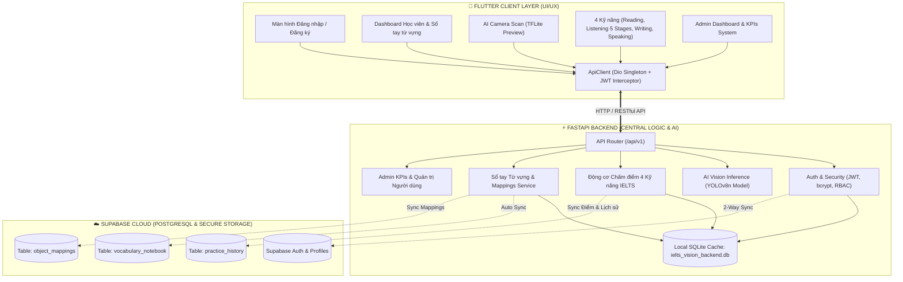

# 📘 IELTS Vision: Tài Liệu Kiến Trúc Hệ Thống (Fullstack Architecture & Deployment Guide)

Hệ thống **IELTS Vision** (`AppHocTiengAnh`) được tái cấu trúc hoàn chỉnh theo mô hình **Client - Server Decoupled Architecture**:
- **Backend**: **FastAPI (Python 3.12)** đóng vai trò trung tâm tính toán, xác thực JWT, phân quyền RBAC, suy luận AI Vision (YOLOv8n), bộ chấm điểm tự động 4 kỹ năng IELTS, và cầu nối đồng bộ 2 chiều với **PostgreSQL Supabase Cloud**.
- **Frontend**: **Flutter (Dart)** chịu trách nhiệm toàn bộ về UI/UX hiện đại, camera preview on-device, TTS phát âm bản xứ, và giao tiếp an toàn với Backend qua `Dio` Network Layer với Auth Interceptor.

---

## 1. Sơ Đồ Kiến Trúc Tổng Thể (System Architecture)



---

## 2. Cấu Trúc Thư Mục Dự Án (Project Structure)

### A. Thư mục `backend/` (FastAPI Server)
```
backend/
├── app/
│   ├── api/
│   │   └── v1/
│   │       ├── endpoints/
│   │       │   ├── auth.py         # Đăng nhập, đăng ký, lấy profile
│   │       │   ├── users.py        # Quản lý người dùng
│   │       │   ├── admin.py        # KPIs, báo cáo phân bố Band điểm
│   │       │   ├── vision.py       # API upload ảnh & suy luận YOLOv8
│   │       │   ├── vocabulary.py   # CRUD 82 nhãn YOLOv8, tra từ nhanh
│   │       │   ├── notebook.py     # CRUD Sổ tay từ vựng
│   │       │   └── skills.py       # Bài học 4 kỹ năng & Chấm điểm server-side
│   │       └── router.py           # Gom tất cả router v1
│   ├── core/
│   │   ├── config.py               # Pydantic Settings & nạp .env
│   │   ├── security.py             # Bcrypt hashing & JWT Token encoder/decoder
│   │   ├── deps.py                 # Dependency injection (get_current_user, get_current_admin)
│   │   └── supabase.py             # Supabase Client kết nối Cloud
│   ├── db/
│   │   ├── base.py                 # Base ORM & import models
│   │   └── session.py              # SQLAlchemy engine & SessionLocal
│   ├── models/
│   │   ├── user.py                 # Bảng User (RBAC: learner, admin)
│   │   ├── mapping.py              # Bảng ObjectMapping (82 nhãn YOLO)
│   │   ├── notebook.py             # Bảng NotebookItem
│   │   └── skill.py                # Bảng SkillLesson, PracticeHistory, ListeningProgress
│   ├── schemas/                    # Pydantic validation schemas
│   ├── services/                   # Business logic (User, Mapping, Notebook, Skill, Vision, Dict)
│   └── main.py                     # Khởi tạo FastAPI app, CORS, lifespan auto-seed
├── .env                            # Biến môi trường & Khóa API Supabase
├── .env.example                    # File mẫu cấu hình môi trường
├── requirements.txt                # Danh sách thư viện Python
├── run.py                          # Script khởi chạy uvicorn server (Port 8000)
├── test_all_phases.py              # Bộ test E2E kiểm thử toàn diện 8 module
├── test_phase2.py                  # Test Auth & RBAC
├── test_phase3.py                  # Test Vocabulary & YOLOv8
└── test_phase4.py                  # Test 4 Kỹ năng IELTS & Gamification
```

### B. Thư mục `lib/` (Flutter Client)
```
lib/
├── core/
│   ├── network/
│   │   ├── api_endpoints.dart      # URLs thông minh (Android: 10.0.2.2, Windows: 127.0.0.1)
│   │   └── api_client.dart         # Dio Singleton + Auth JWT Interceptor
│   ├── services/
│   │   ├── dictionary_service.dart # Tap-to-Translate qua FastAPI
│   │   └── practice_service.dart   # Nộp bài thi qua FastAPI với fallback Supabase
│   └── theme/                      # AppColors, Gradient, Typography
├── data/
│   ├── datasources/
│   │   └── api_service.dart        # Central API Gateway cho mọi chức năng UI
│   ├── models/                     # UserModel, ObjectMappingModel, VocabularyItemModel, SkillModels
│   └── repositories/               # SkillRepository dữ liệu mẫu & fallback
└── presentation/
    ├── auth/providers/             # AuthProvider kết nối JWT Login
    ├── admin/screens/              # AdminDashboardScreen (KPIs, Users, Mappings)
    └── learner/
        ├── screens/
        │   ├── learner_home_screen.dart        # Home dashboard
        │   ├── camera_scan_screen.dart         # Camera AI Scanner
        │   ├── vocabulary_notebook_screen.dart # Sổ tay từ vựng
        │   ├── reading_practice_screen.dart    # Luyện đọc & chấm điểm
        │   ├── listening_practice_screen.dart  # Luyện nghe 5 ải vượt cấp
        │   ├── writing_practice_screen.dart    # Luyện viết & Collocations
        │   └── speaking_practice_screen.dart   # Luyện nói Cue Card & Band
        └── widgets/                            # VocabularyDetailBottomSheet,...
```

---

## 3. Hướng Dẫn Cài Đặt & Chạy Hệ Thống

### Bước 1: Khởi động Backend FastAPI
```bash
# 1. Di chuyển vào thư mục backend hoặc root
cd d:\AppHocTiengAnh

# 2. Cài đặt các thư viện cần thiết
pip install -r backend/requirements.txt

# 3. Khởi động máy chủ backend (Hot reload tự động)
python backend/run.py
```
> Server sẽ hoạt động tại: **`http://127.0.0.1:8000`**  
> Tài liệu Swagger UI tương tác trực tiếp: **`http://127.0.0.1:8000/api/v1/docs`**

### Bước 2: Khởi động Flutter Frontend
```bash
# 1. Tải các dependencies
flutter pub get

# 2. Chạy ứng dụng trên Windows Desktop, Android Emulator hoặc Chrome
flutter run -d windows
# Hoặc chạy trên Android:
flutter run -d emulator-5554
```

---

## 4. Tài Khoản & Phân Quyền (RBAC Credentials)

Hệ thống tự động khởi tạo (seed) sẵn 2 tài khoản mặc định khi backend khởi động lần đầu:

| Vai trò (Role) | Username | Password | Quyền hạn |
| :--- | :--- | :--- | :--- |
| **Admin** | `admin` | `password123` | Toàn quyền xem KPIs, CRUD 82 nhãn từ vựng AI, quản lý danh sách Users, reset dữ liệu gốc |
| **Learner** | `learner` | `password123` | Quét camera AI, nộp bài 4 kỹ năng IELTS, tra từ điển, lưu sổ tay cá nhân |

---

## 5. Danh Mục Endpoints Chính (API Reference)

| Phương thức | Endpoint | Mô tả | Quyền yêu cầu |
| :--- | :--- | :--- | :--- |
| `POST` | `/api/v1/auth/login` | Đăng nhập lấy Bearer JWT Token | Public |
| `POST` | `/api/v1/auth/register` | Đăng ký tài khoản học viên mới | Public |
| `GET` | `/api/v1/auth/me` | Lấy thông tin tài khoản hiện tại | Learner / Admin |
| `GET` | `/api/v1/admin/kpis` | Báo cáo KPIs, tổng nhãn, users, phân bố Band | **Chỉ Admin** |
| `GET` | `/api/v1/vocabulary/mappings` | Lấy danh sách toàn bộ 82 nhãn YOLOv8 | Learner / Admin |
| `POST` | `/api/v1/vocabulary/mappings` | Thêm mới nhãn từ vựng học thuật | **Chỉ Admin** |
| `PUT` | `/api/v1/vocabulary/mappings/{id}` | Cập nhật thông tin từ vựng của nhãn | **Chỉ Admin** |
| `DELETE`| `/api/v1/vocabulary/mappings/{id}` | Xóa nhãn từ vựng khỏi hệ thống | **Chỉ Admin** |
| `POST` | `/api/v1/vocabulary/mappings/reset` | Khôi phục 82 nhãn gốc từ file JSON | **Chỉ Admin** |
| `GET` | `/api/v1/vocabulary/lookup` | Tra cứu nghĩa nhanh (Tap-to-Translate) | Learner / Admin |
| `POST` | `/api/v1/vision/detect` | Tải ảnh lên và suy luận qua YOLOv8n | Learner / Admin |
| `GET` | `/api/v1/notebook/` | Lấy danh sách sổ tay của học viên | Learner |
| `POST` | `/api/v1/notebook/` | Lưu từ vựng vào sổ tay (đồng bộ Cloud) | Learner |
| `DELETE`| `/api/v1/notebook/{id}` | Xóa từ khỏi sổ tay học tập | Learner |
| `GET` | `/api/v1/skills/{skill}/lessons` | Lấy danh sách bài học 4 kỹ năng | Learner |
| `POST` | `/api/v1/skills/submit` | Nộp bài thi chấm điểm tự động | Learner |
| `GET` | `/api/v1/skills/listening/progress` | Lấy tiến độ 5 ải vượt cấp Listening | Learner |
| `GET` | `/api/v1/skills/history` | Lấy lịch sử làm bài tập 4 kỹ năng | Learner |
| `GET` | `/api/v1/auth/face/nonce` | Lấy mã thử thách tạm thời 60s (chống Replay) | Công khai |
| `POST` | `/api/v1/auth/face/login` | Đăng nhập sinh trắc học FaceID 1:1 hoặc 1:N | Công khai |
| `POST` | `/api/v1/auth/face/register` | Đăng ký hoặc cập nhật vector khuôn mặt 128D | Bearer Token |
| `GET` | `/api/v1/auth/face/status` | Lấy trạng thái đăng ký FaceID hiện tại | Bearer Token |
| `DELETE`| `/api/v1/auth/face` | Hủy liên kết khuôn mặt FaceID | Bearer Token |

---

## 6. Động Cơ Chấm Điểm & Đánh Giá Máy Chủ

1. **Reading Evaluation Engine**:
   - Tự động đối soát từng đáp án trắc nghiệm với `correct_answer`.
   - Quy đổi số câu đúng sang thang điểm IELTS Band chuẩn (ví dụ 3/3 câu -> Band 8.5+).
2. **Listening Gamification Engine (5 Stages)**:
   - Cơ chế vượt ải cấp tiến:
     - Ải 1: Cơ bản (Band 6.0)
     - Ải 2: Trung cấp (Band 7.0)
     - Ải 3: Nâng cao (Band 7.5)
     - Ải 4: Chuyên sâu (Band 8.0)
     - Ải 5: Bậc thầy (Band 8.5+ - Boss Stage)
   - Tự động tính số sao (1⭐ - 3⭐) và mở khóa ải kế tiếp khi đạt điểm yêu cầu.
3. **Writing Automated Assessment Engine**:
   - Đếm số từ thực tế: Task 1 yêu cầu tối thiểu 150 từ (dưới 150 từ tự động hạ Band).
   - Quét từ vựng học thuật & Collocations chuẩn Band 7.5 - 8.5 (`delineates`, `upward trajectory`, `disparity narrowed`, `plateaued`, `digital divide`,...).
4. **Speaking Assessment Engine**:
   - Đánh giá đa chiều dựa trên 3 tiêu chí cốt lõi: Độ lưu loát (Fluency), Vốn từ vựng (Lexical Resource), Phát âm (Pronunciation).
   - Tự động đồng bộ điểm số vào bảng `practice_history` trên Supabase.

---

## 7. Cơ Chế Đồng Bộ Supabase Cloud 2 Chiều

Backend đóng vai trò kiểm soát an ninh (Security Gateway), bảo vệ `SUPABASE_SERVICE_ROLE_KEY` không bị lộ ở client:
- Khi người dùng đăng ký hoặc đăng nhập, backend tự động kiểm tra và tạo UUID tương ứng tại bảng `profiles`.
- Khi lưu hoặc xóa từ trong Sổ tay, backend ghi nhận vào cơ sở dữ liệu local SQLite đồng thời gọi REST API Supabase để đồng bộ sang bảng `vocabulary_notebook`.
- Lịch sử làm bài tập 4 kỹ năng được lưu vào bảng `practice_history` với đầy đủ timestamp, tên bài học, điểm số và Band điểm ước tính.

---

## 8. Kết Quả Kiểm Thử Toàn Diện (Verification)

Chạy kiểm thử toàn diện hệ thống:
```bash
# Kiểm thử Backend End-to-End
python backend/test_all_phases.py
# Kết quả: HOÀN THÀNH 100% CÁC BƯỚC KIỂM THỬ END-TO-END HỆ THỐNG! (Exit code 0)

# Phân tích mã nguồn Flutter
flutter analyze
# Kết quả: No issues found! (0 errors, 0 warnings)
```
